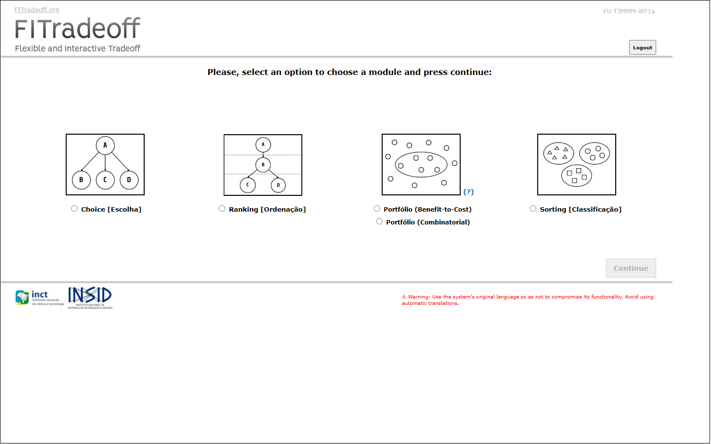
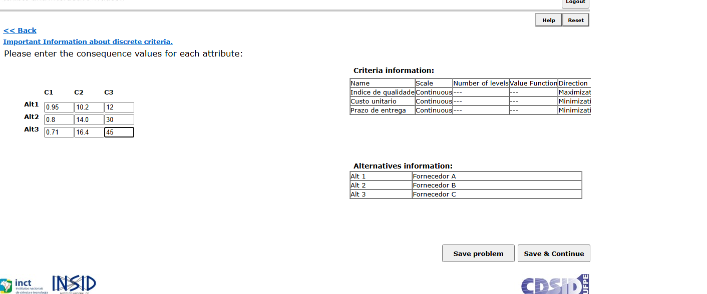
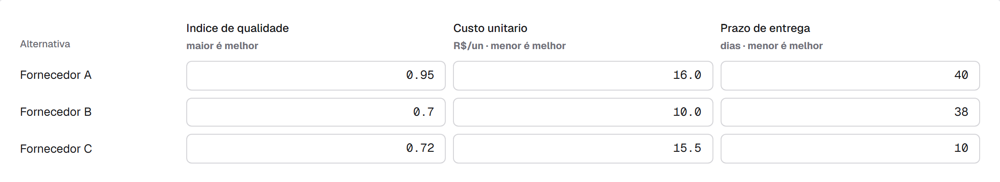
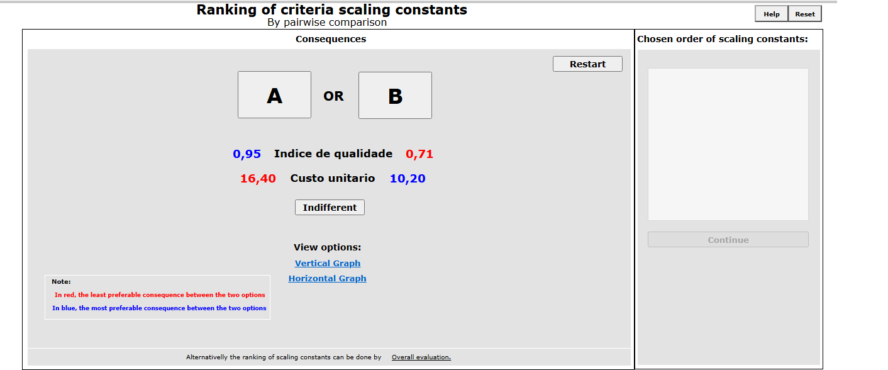
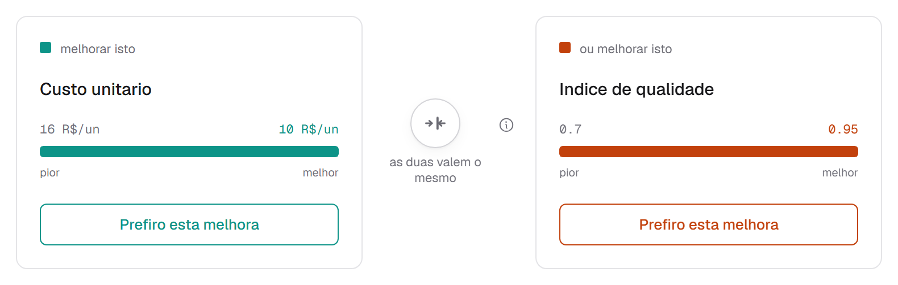
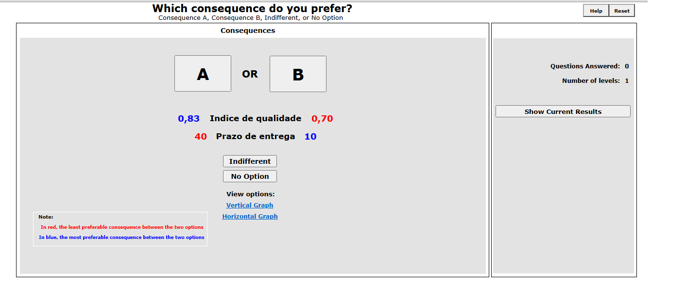
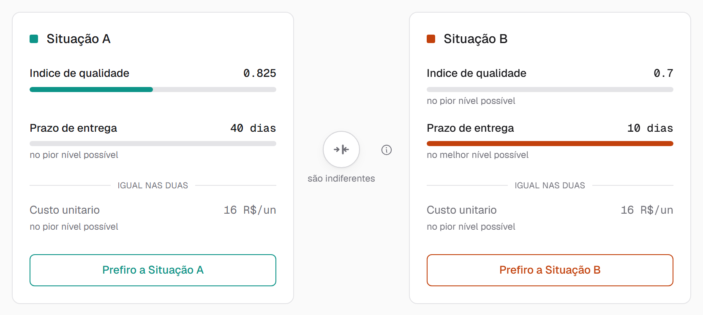
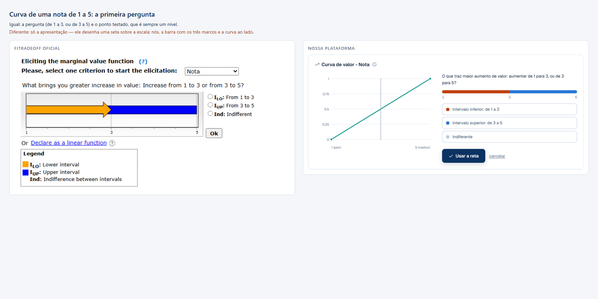
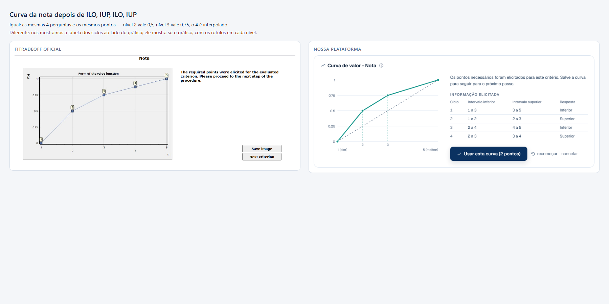
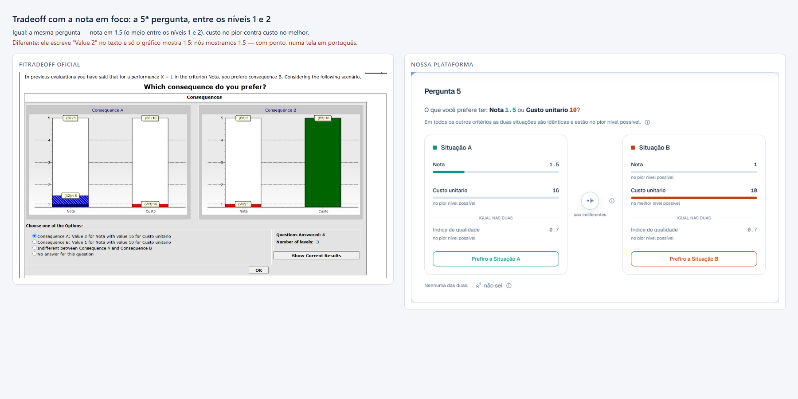

# Equivalência com o FITradeoff oficial

O [PARIDADE.md](../PARIDADE.md) compara **recursos**: o que existe de um lado e
do outro, levantado do guia do usuário. Este documento compara **comportamento**:
os mesmos problemas rodados nos dois sistemas, pergunta a pergunta, resultado a
resultado.

A distinção importa. Ter a mesma tela não é fazer a mesma coisa; e foi só ao
rodar lado a lado que apareceram três divergências reais de método, todas
corrigidas — e duas que permanecem, documentadas aqui.

O sistema de referência é o `FU-T3MMM-WF1a` do CDSID/UFPE, acessado pelo
navegador, na conta do próprio usuário.

## Como a comparação é feita

Cada caso é cadastrado nos dois sistemas com as mesmas alternativas, os mesmos
critérios e a mesma matriz de desempenhos, e respondido com a **mesma política:
sempre a opção A**.

A política fixa não é a resposta de um decisor real. É a única forma de o
percurso ser reproduzível dos dois lados — e o que se verifica não é "a
recomendação está certa", que depende da preferência de quem responde, e sim que
os dois sistemas **fazem as mesmas perguntas e chegam ao mesmo lugar**.

Dois parâmetros são igualados de propósito: função de valor **linear** em todos
os critérios (o oficial oferece "declare linear function for all criteria") e
limiar de equivalência em **0,01**, que é o padrão dele.

Os casos crescem até 20 alternativas por um motivo: com três ou quatro, duas
implementações concordam por coincidência, porque há poucos caminhos possíveis.
Com 20 são 190 pares para ordenar e 2²⁰ subconjuntos de carteira.

## As telas, lado a lado

O fluxo do oficial é: escolher o módulo → cadastrar → matriz → função de valor →
Input Page → ordenar as constantes de escala → elicitação por decomposição →
resultado. A nossa interface segue a mesma progressão, com os passos nomeados.

**Escolha do módulo.** As cinco problemáticas, escolhidas antes de tudo.



**Matriz de desempenhos.** Alternativas nas linhas, critérios nas colunas. No
oficial os critérios aparecem como `C1`, `C2`, `C3`, com uma tabela de apoio ao
lado dizendo qual é qual; na nossa o nome e a direção ficam no cabeçalho da
coluna, e dá para colar a tabela inteira do Excel.




**Ordenação das constantes de escala.** Comparação par a par, com a faixa de
cada critério desenhada. É o mesmo par, no mesmo ponto, nos dois sistemas.




**Pergunta de tradeoff.** Duas consequências hipotéticas, ambas ruins em quase
tudo. O oficial desenha as duas como barras; nós mostramos os valores por
critério e marcamos o que é idêntico nas duas situações.




## Resultados

<!-- inicio:tabela -->
| Caso | Alt × Crit | Oficial `ord/tradeoff` | Nosso `ord/tradeoff` | |
|---|---|---|---|---|
| `escolha-dominante` | 3 × 3 | 3/0 | 3/0 | **bate** |
| `escolha-minima` | 2 × 2 | 1/1 | 1/1 | **bate** |
| `ranking-cruzado` | 3 × 3 | 3/8 | 3/8 | **bate** |
| `escolha-06` | 6 × 5 | 8/10 | 8/10 | **bate** |
| `ranking-06` | 6 × 5 | 8/14 | 8/14 | **bate** |
| `sorting-04` | 4 × 3 | 3/6 | 3/6 | **bate** |
| `escolha-12` | 12 × 5 | 8/6 | 8/6 | **bate** |
| `ranking-12` | 12 × 5 | 8/14 | 8/14 | **bate** |
| `escolha-15` | 15 × 3 | 3/6 | 3/6 | **bate** |
| `ranking-15` | 15 × 3 | 3/12 | 3/12 | **bate** |
| `sorting-06` | 6 × 5 | 8/18 | 8/18 | **bate** |
| `bc-08` | 8 × 4 | 5/17 | 5/17 | **bate** |
| `escolha-20` | 20 × 5 | 8/12 | 8/12 | **bate** |
| `ranking-20` | 20 × 5 | 8/21 | 8/21 | **bate** |
| `sorting-20` | 20 × 4 | 5/17 | 5/17 | **bate** |
| `bc-20` | 20 × 4 | 5/17 | 5/17 | **bate** |
| `escolha-empate` | 3 × 3 | **trava** | 3/0 | oficial não completa |

**16 de 16 casos** que o sistema oficial completa batem em número de perguntas, nas duas fases — ordenação das constantes de escala e elicitação por decomposição. Em 1 caso o oficial não completa.
<!-- fim:tabela -->

## O que a comparação encontrou

Três divergências de método, achadas pelo mesmo procedimento: capturar as duas
sequências de perguntas e diferenciar. Nas três, as perguntas iniciais eram
**idênticas** — mesmos pares, mesmos pontos de bisseção — e a diferença estava
em **quando cada sistema para**.

As três correções estão no motor, e duas delas precisaram de uma segunda medida
para valer de fato. A regra do sorting encontrada na primeira instância — a
largura da faixa — não descrevia o método: uma segunda instância deu o
contraexemplo, e o critério verdadeiro (a sobra sobre o corte, contra metade do
limiar) só apareceu com os dois pontos de medida na mesa.

O risco fica registrado porque é de método, não de código: regra inferida de uma
instância passa nos testes escritos contra aquela instância. É por isso que a
suíte roda os 17 casos, e não um. De 10 para **14 de 16** — e, em 28/09/2026,
para **16 de 16**, com as duas seções abaixo.

### A pergunta de abertura

O oficial abre a elicitação confrontando o critério **mais importante com o
menos importante**, e só depois refina par a par. Nós só perguntávamos sobre
pares consecutivos, o que dava sempre uma pergunta a menos.

Com três critérios ele abre com `qualidade × prazo`; com cinco, `qualidade ×
suporte técnico`. É a razão de pesos mais larga que existe, então respondê-la
corta o espaço de pesos no ponto de maior ignorância.

Detalhe que não é cosmético: a razão extrema é o **produto** das razões
consecutivas, e cada fator está em (0, 1]. Um piso no produto é piso em cada
fator, e precisa ser propagado — sem isso o seletor pergunta dentro de uma faixa
que já não existe, e responder "B" esvazia o espaço de pesos. O decisor receberia
"as declarações se contradizem" por ter respondido o que lhe foi perguntado.

### O limiar de equivalência, e o que ele não era

O `epsilon` do nosso motor estava documentado como equivalente ao *equivalence
threshold* do oficial. Não era. O nosso é folga de restrição entre as constantes
de escala de dois **critérios**; o dele compara os valores globais de duas
**alternativas** para declará-las indiferentes. Objetos distintos com o mesmo
nome — o que custou um diagnóstico errado antes de ser percebido.

O limiar de verdade passou a existir, com o padrão 0,01 do oficial, e entra como
**folga no teste de dominância**. A medida que fechou isso: num caso de 12
alternativas, depois de 14 respostas,

```
max(V[Alt 07] − V[Alt 01]) = 0.009222
max(V[Alt 01] − V[Alt 07]) = 0.057143
```

Alt 01 nunca fica mais de 0,0092 atrás — abaixo do limiar. O oficial declara a
dominância; nós exigíamos vantagem até a última casa e gastávamos quatro
perguntas atrás de uma diferença que ninguém sente.

Isso trouxe uma consequência que precisou de tratamento: dominância com folga
deixa de ser antissimétrica, e duas alternativas próximas "superam" as duas.
Somado como dominância dupla, produzia faixa de posição **invertida** — `[12-11]`,
primeira posição maior que a última, indo para a tela. Empate passou a ser lido
como empate, e o ranking fecha como **pré-ordem** — a mesma palavra que o
oficial usa ("A complete pre-order has been found").

### O sorting decide pela largura da faixa

Mesma investigação, terceiro resultado. As 18 primeiras perguntas idênticas; no
passo 18 sobrava uma alternativa atravessando um corte:

```
passo 17: faixa [0.6912, 0.7083]  largura 0.0171  atravessa por 0.0083
passo 18: faixa [0.6995, 0.7083]  largura 0.0088  atravessa por 0.0005
```

O critério não é a **profundidade** do cruzamento — 0,0083 no passo 17 já caberia
em qualquer limiar de 0,01, e mesmo assim ele seguiu perguntando. É a **largura**
da faixa: se o valor global não pode mais ser fixado com precisão melhor que o
limiar, nenhuma pergunta futura decide de que lado do corte a alternativa está.

### Ranking: o oficial abandona o par que já não pesa

`ranking-20` fazia 22 perguntas contra 21 dele. As 20 primeiras eram idênticas;
no passo 21 o oficial **abandona** o par `Durabilidade × Suporte técnico`, que
ainda tinha faixa, e vai direto ao par que fecha a ordem.

A causa ficou desconhecida enquanto se procurou no seletor — trocá-lo por
`InformationGainSelector` dava 10 perguntas e afastava do oficial cinco casos
que batiam. Estava no **peso**. Medido no nosso motor com as mesmas respostas,
o peso máximo possível do critério rival em cada pergunta:

| passo | par | rival pode pesar até | o oficial |
|---|---|---|---|
| 17 | Durabilidade × Suporte | 2,86e-5 | perguntou |
| 20 | Prazo × Durabilidade | 5,91e-5 | perguntou |
| 21 | Durabilidade × Suporte | 1,85e-6 | **pulou** |

Pular a pergunta quando o rival não pode pesar mais que um limiar dentro dessa
janela dá as mesmas 21 perguntas, uma a uma, e não muda a sequência de nenhum
dos outros 16 casos. Está em `PESO_DESPREZIVEL`,
`engine/src/fitradeoff/elicitation/selectors.py`.

A janela estreitou depois (28/09/2026), com o `sorting-20` de qualidade
reescalada e custo em milhares — um caso em que o par `Custo × Prazo` só acaba
pelo peso. Ele perguntou com o prazo podendo pesar 7,40e-6 e parou com 3,70e-6:
25 perguntas, uma a mais que o `1e-5` que usávamos, que caía fora da janela nova.
O limiar agora é `5e-6`, dentro dos dois intervalos medidos.

### Benefício-custo: ele só para quando a ordem das razões fecha

`bc-20` fazia 11 perguntas contra 17 dele, com a mesma carteira — conferida
projeto a projeto entre 2²⁰ subconjuntos. A nossa parada disparava quando a
carteira ficava única; a dele, depois.

Cinco hipóteses tinham sido refutadas: separação das faixas de razão, largura das
faixas de razão, largura das faixas de valor, esgotamento da bissecção,
resolução mais grossa de bracket. A que faltava era a mais natural para quem
ordena por razão: **ordem par a par, por dominância** — para cada par de
projetos, a razão benefício/custo de um supera a do outro em todo peso ainda
admissível (dois LPs por par; faixas disjuntas dispensam o LP). Não é o mesmo
que faixas disjuntas: duas faixas podem se sobrepor e a ordem entre as razões
ainda assim ser a mesma em todo peso.

O dado que apontou o caminho: rodando `bc-20` com a parada do *ranking*, saem as
mesmas 17 perguntas dele, na mesma ordem. A parada do ranking não serve — em
`bc-08` ela dá 11 contra 17 —, mas mostrou que ele continua até **ordenar**. Com
a ordem das razões por dominância estrita, `bc-08` e `bc-20` param depois de
exatamente 17 perguntas, como o oficial.

A carteira continua a mesma. A tela diz quando ela já está definida e a ordem
ainda não.

### Com curva não linear: o par se encerra na unidade do critério

Os 16 casos acima usam função de valor linear. Em 28/09/2026 levamos quatro
decisões inteiras com curva elicitada aos dois sistemas, com as mesmas respostas
de curva por critério. Ranking, escolha e sorting bateram de primeira (3, 3 e 4
perguntas de tradeoff, mesmo resultado, mesmas faixas de valor). `bc-08` não:
**21 perguntas dele contra 14 nossas**, e carteira diferente.

Duas regras faltavam, e cada uma só aparece com curva.

**A curva.** No ponto 0,5, o oficial às vezes descarta a terceira resposta e
fica com o último ponto testado. A regra certa só saiu na terceira leitura: ele
compara o ponto testado com a *metade da largura da escala*, sem somar o pior
— acima dela perde-se a resposta que subiria o limite de baixo; abaixo, a que
desceria o de cima. As duas leituras anteriores ("terceira resposta igual à
primeira", depois "só perto do zero") eram casos particulares desta, e cada uma
caiu com uma escala nova; a Durabilidade do `bc-08` (4,92 a 8,87) derrubou a
segunda. A regra está em `web/lib/curvaDeValor.ts` e reproduz as 38 rodadas
medidas.

**O fim de um par.** Com as curvas iguais, as sequências de tradeoff seguiram
idênticas até a 10ª pergunta. Na 11ª o oficial abandona `Qualidade × Custo`, que
nós continuávamos perguntando:

```
pergunta 8:  Qualidade 0,6145 ("0,61" na tela) × Custo 9,02
restante:    Qualidade entre 0,609 e 0,6145 -- as duas pontas "0,61"
```

Ele encerra um par quando a faixa ainda possível, levada à **consequência**, fica
mais estreita que 0,01 — na unidade do critério. Aqui, 0,609 a 0,6145: largura
0,0055. Nós encerrávamos pelo **valor** (faixa abaixo de 0,01), e com curva a
mesma faixa de valor cabe numa fatia de consequência muito diferente.

Com a regra dele (`LARGURA_MINIMA` em `engine/src/fitradeoff/elicitation/selectors.py`)
as 21 perguntas saem iguais, uma a uma, e o fim também: Alt 05 e Alt 08 sem
ordem, porque o peso do custo nunca chega a ser apertado, e a Alt 05 na carteira.
Nos 16 casos lineares e nas outras três decisões com curva, nenhuma contagem
muda.

A regra teve duas leituras parciais antes desta, as duas do tipo "o que a tela
mostra": as pontas da faixa iguais com duas casas ("0,61" e "0,61"), e a pergunta
que mostraria o pior exato (0,7039, que aparece "0,70", numa escala que começa em
0,70). Juntas, explicavam todas as medidas até então. Para testá-las numa escala
nova, a simulação procurou um caso em que a segunda leitura mudasse a contagem, e
achou o `sorting-20` com a qualidade reescalada para 0,60..0,80: 24 perguntas com
ela, 17 sem ela. O oficial fez **22**. As 22 dele são idênticas às nossas com a
regra até o fim, onde ele para com o custo entre 17,668 e 17,677 — as pontas
"17,67" e "17,68", diferentes na tela, mas a faixa com 0,0086. A largura em
consequência explica as três medidas que as leituras anteriores explicavam, e
esta também. O corte dele está entre 0,0086 (a maior faixa em que parou) e 0,011
(a menor em que perguntou).

Duas hipóteses foram refutadas no caminho, por simulação contra os 20 casos:
bissecção no meio da *consequência* em vez do valor (quebra o ranking e o sorting
com curva) e pergunta com a consequência *arredondada* (quebra 12 dos 16
lineares). Arredondamento de tela não entra em nada: nem no que se pergunta,
nem em quando o par acaba.

### Escala construída: curva em nível, tradeoff entre níveis

O oficial só aceita escala construída como Likert: 2 a 7 níveis, de 1 a n (ou 0
e 1). A curva dela tem regra própria, medida em 28/09/2026 com 3, 4 e 5 níveis:
a mesma pergunta de bissecção, mas o ponto testado é sempre um nível (o do meio
da faixa, arredondado para cima), a busca para quando não sobra nível dentro da
faixa e fica com o último testado, e um ponto de quarto sem nível dentro é
pulado. O valor, portanto, só cai em nível. Com 2 níveis não há o que perguntar,
e com 6 ou 7 o critério nem aparece na avaliação intra-critério — fica linear.
Nós fazíamos a bissecção contínua e fixávamos pontos entre níveis; agora a regra
é a dele (`web/lib/curvaDeValor.ts`), e a tela só oferece a curva de 3 a 5
níveis.

No tradeoff, ao contrário, ele pergunta **entre** níveis, numa tela própria de
critério discreto, mas não em qualquer ponto: entre dois níveis, só no terço, no
meio e nos dois terços. Com a nota de 1 a 5 no meio da ordem, depois de "nota 2"
vem 1,5, e depois 1,33 ou 1,67 conforme a resposta — e acabou, porque entre 1 e 2
não há mais o que perguntar. Entre 2 e 3, o mesmo: 2,5, depois 2,33 ou 2,67. A
escolha é a de qualquer escala discreta, o valor mais perto do meio da faixa.
Foram cinco rodadas com respostas diferentes, e o valor exato lido no gráfico
dele em cada uma; nós fazíamos bissecção contínua (1,25 onde ele pergunta 1,33) e
seguíamos perguntando até a faixa esgotar. Uma hipótese intermediária —
"a tela mostra inteiro, e o par para quando as pontas mostram o mesmo inteiro" —
explicava as duas primeiras rodadas e caiu na terceira, em que ele pergunta 1,67
com a faixa entre 1,5 e 2, as duas pontas "2".

Sem curva, nada disso: com a mesma nota declarada linear, ele pergunta só nos
níveis (3, depois 2 ou 4), exatamente como nós — duas rodadas, 6 perguntas
iguais, ordem completa nas duas. O terço e o meio são coisa de critério discreto
com curva.

As telas, nos mesmos estados — cada imagem diz o que é igual e o que difere:





Nas outras problemáticas o critério discreto se comporta igual: a mesma nota no
meio da ordem, com curva, deu as mesmas perguntas e o mesmo resultado em escolha
(3 perguntas, Alt 1), sorting (4, as mesmas classes) e benefício-custo (4, a
mesma carteira).

Com essas regras as seis decisões com critério construído e curva saem iguais à dele:
mesmos pares, na mesma ordem, os mesmos valores, a mesma contagem e o mesmo
desfecho. Os 20 casos anteriores não mudam.

### 29/09/2026: sete decisões, e duas regras de ordem

Uma rodada de manhã, com o script de medição corrigido, levou sete decisões ao
oficial: a validação (repete um caso já conhecido e saiu idêntica), as três com a
nota em foco em escolha, benefício-custo e sorting de cinco critérios, e três de
borda — duas alternativas a 0,1% uma da outra, um critério de só dois valores
com o custo em milhares e o prazo em frações, e uma nota de 7 níveis sem curva.
Quatro bateram de primeira; as outras três mostraram duas regras de **ordem**
que faltavam:

- **A pergunta entre níveis vai para o fim.** Com a nota em foco e cinco
  critérios, o oficial só pergunta a nota entre níveis quando não sobra outra
  pergunta: na escolha, as duas (1,5 e 1,33) são a 23ª e a 24ª; no sorting ele
  classifica tudo antes de chegar nelas. Nós fazíamos pela largura da faixa, e
  essa pergunta costuma ter a mais larga.
- **Empate de distância entre dois níveis vai para o de baixo.** Numa nota de 1 a
  7 com a faixa de 0 a 0,5, os níveis 2 e 3 ficam a 1/12 do meio; ele pergunta o
  2, nós perguntávamos o 3.

Com as duas, as sete saem com a mesma sequência de pares, uma a uma
(`resultados/casos_medidos_2026_09_29.json`, preso em `test_paridade`).

Uma nota de método: a primeira versão do script de medição dava a página por
mudada quando qualquer texto mudava, e o oficial mexe em pedaços da tela enquanto
processa. Numa noite lenta isso chegou a registrar oito respostas de curva que
ele nunca recebeu. Nenhuma medida usada aqui foi afetada — todas batiam pergunta
a pergunta com as previsões, e uma resposta fantasma teria aparecido como
divergência —, mas a condição agora é a pergunta mudar, ou o contador "Questions
Answered" subir.

## O que permanece diferente

### Portfólio combinatorial: não comparável em sessão

O módulo de Portfólio Combinatorial roda num deploy separado
(`fitradeoffportcombinatorio.dll`, versão `FU-TXPNM-WF1`) e pede login de novo.
Depois de salvar a matriz ele **não elicita**: entra num processamento
assíncrono —

> *"The set of feasible portfolios is being generated. Depending on the number
> of criteria and projects, this process may take a few minutes. We'll send you
> a notification through the registered e-mail as soon as this process is
> finished."*

Quatro casos ficaram sete minutos sem concluir, inclusive um com orçamento menor
que o projeto mais barato, cujo conjunto viável é trivial. É diferença de
arquitetura: ele enumera carteiras offline, nós aproximamos por amostragem de
vértices e respondemos na hora.

Voltamos dois dias depois (28/09/2026). Nenhum e-mail de conclusão chegou, e os
nove projetos submetidos não abrem: em "Continue a registered issue", selecionar
qualquer um deles faz o sistema responder com uma exceção interna — *"'' is not
a valid integer value"* — e a tela trava. Só abrem os dois que nunca tiveram a
matriz salva. Então o resultado do portfólio combinatorial não fica acessível
por nenhum dos dois caminhos que ele oferece, e a comparação não tem como ser
feita.

## Onde o oficial não completa

Com **matriz degenerada** — todas as alternativas idênticas — o oficial trava, e
no mesmo ponto nos dois módulos testados: depois do `Save & Continue`, a tela de
Intra-Criteria Evaluation nunca aparece. Faz sentido: com alternativas iguais
todo critério tem faixa zero, e a elicitação da função valor não tem o que fazer.

Nós respondemos, e desde o limiar de equivalência respondemos bem: *"3
alternativas ficaram equivalentes dentro do limiar de 0,01: qualquer uma delas
serve; mais perguntas não separariam."*
